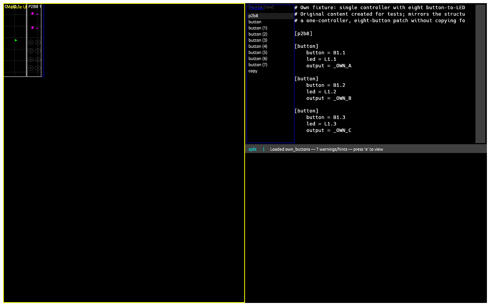
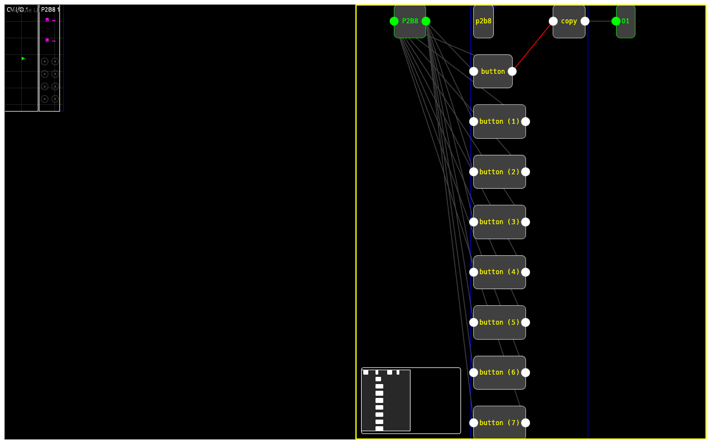

# Getting started

## What it is

`droid_tui` loads a DROID `.ini` patch and shows you what it does:
which hardware controls it uses, what the source says, how signals
flow between circuits, and whether the patch is valid. It can also
send the patch to DROID hardware over MIDI SysEx (see
[Uploading](uploading.md)).

It never edits your `.ini` files. Labels you assign are stored
separately per patch (see [Labels](labels.md)).

## Install

There are two ways in, and only one of them starts with a compiler.

**Prebuilt (Windows, macOS).** The [releases
page](https://github.com/moonstruxx/droid-buddy/releases) carries two
assets: `droid_tui-<version>-x86_64-pc-windows-msvc.zip`, which holds
`droid_tui.exe` at the zip root, and
`droid_tui-<version>-macos-universal.zip`, a universal `.app` bundle
for Apple silicon and Intel. Unzip and run; there is no installer.
Linux has no prebuilt artifact — build from source.

Both artifacts are unsigned. A downloaded `.app` is quarantined by
Gatekeeper: right-click it and choose **Open**, then confirm. On
Windows, SmartScreen wants **More info → Run anyway**. The exact
prompts and their alternatives are under [unsigned
builds](platforms.md#unsigned-builds).

**From source (all three OSes).**

```sh
git clone <repo> && cd droid_tui
git submodule update --init   # ext/droid-lsp: the circuit-schema source of truth
cargo build --release
```

Prerequisites differ per OS — MSVC build tools on Windows, Xcode
command line tools on macOS, `build-essential` and `pkg-config` on
Linux — and are listed on [Building from source](build.md).

## Run it

| OS | Command |
|---|---|
| Linux | `./target/release/droid_tui [patch.ini]` |
| Windows | `target\release\droid_tui.exe [patch.ini]` |
| macOS, from source | `./target/release/droid_tui [patch.ini]` |
| macOS, `.app` download | double-click `droid_tui.app`, or `open droid_tui.app --args patch.ini` |

With no argument the app opens an embedded demo patch. Your config,
labels and favourites are created on first save, in the platform data
directory — `~/.config/droid-tui/` on Linux and macOS,
`%APPDATA%\droid-tui\` on Windows. [Where your files
live](platforms.md#where-your-files-live) has the full rule.

## First five minutes

1. The app opens with the **Module UI** (left, big pane) and the
   **source viewer** (right, small pane).
   
2. Press `l` to open the file picker, navigate with `j`/`k`, and press
   `Enter` on an `.ini` file. The patch loads — or a validation modal
   tells you why it cannot (see [Views](views.md#validation-modal-e)).
3. Click a faceplate element (or hover it and press `Enter`/`Space` to
   toggle it). A click *focuses* the element: the source viewer jumps
   to its occurrence and the graph highlights its signal path. A click
   never toggles state — `Enter`/`Space` does that.
4. Press `g g` to open the **signal-flow graph** (big pane): circuits
   as nodes, virtual `_cable` connections as directed edges.
   
5. Press `?` any time for the key table of the focused view, and `q`
   to quit.

## Next steps

- [Views](views.md) — what each surface shows and how they link.
- [Keys](keys.md) — every binding, per view.
- [Platforms](platforms.md) — what works on which OS, and where your
  files live.
- [Labels](labels.md) — name your controls per shift layer.
- [Uploading](uploading.md) — send the patch to the rack.
- [Configuration](config.md) — themes, labels policy, layout mode.
