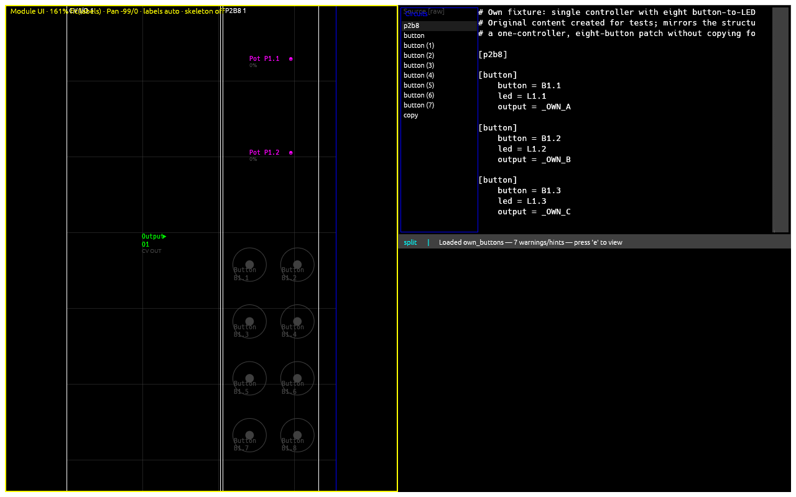
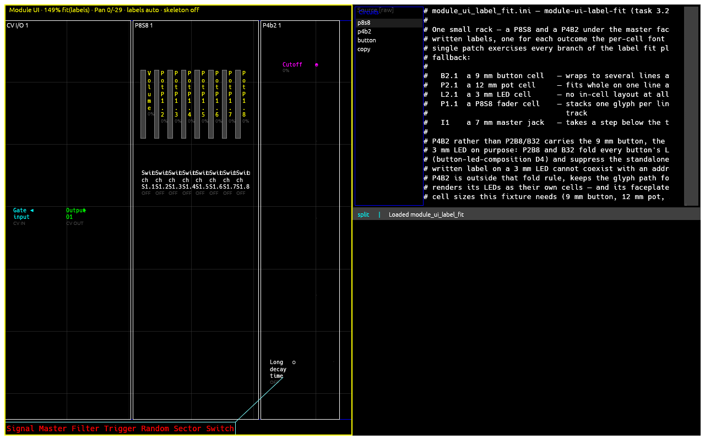
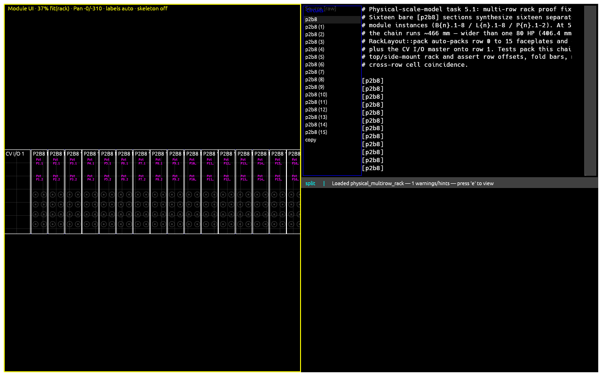
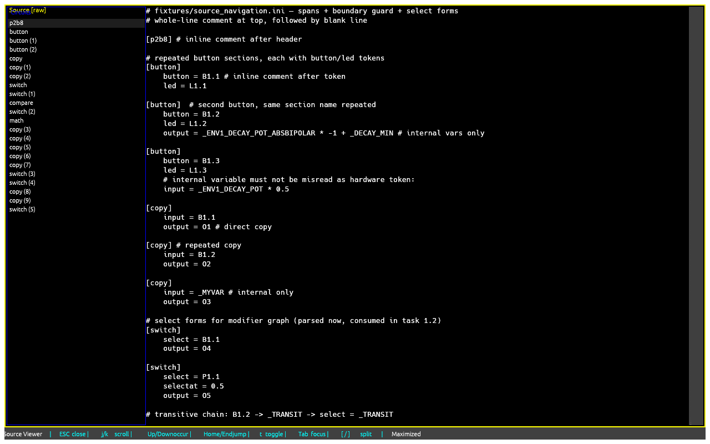
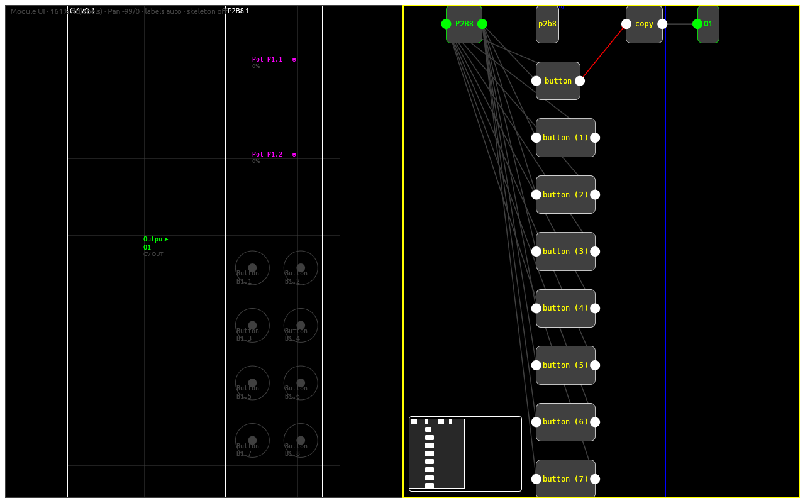
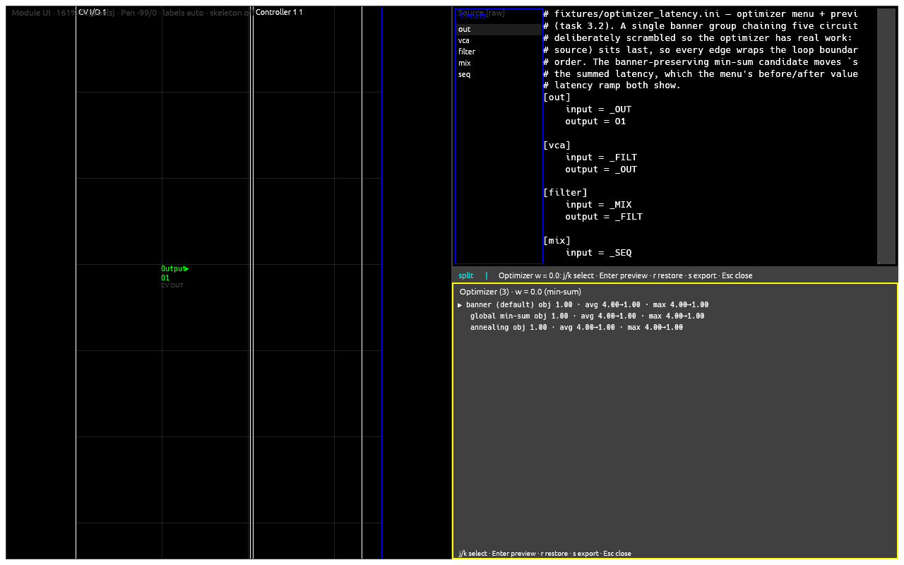

# Views

## The pane layout

The main band is a class-based layout: a full-height left **big**
pane plus a right half that is either one big pane (no small view
open) or two stacked **small** panes. Every view belongs to a class:

- Big: Module UI, signal-flow graph.
- Small: source viewer, latency optimizer.

`Tab` / `Shift+Tab` cycle focus across the open panes in tree order,
`r` rotates the focused pane through its class carousel
(big: graph → Module UI; small: source viewer → optimizer), `z`
maximizes the focused pane, `Alt+b` / `Alt+s` swap same-class panes,
`Esc` closes the focused view. `[` / `]` move the left/right split
(30–70 %), `Alt+[` / `Alt+]` move the small-pane split.

## Module UI

The physical faceplate view — the app's only hardware surface. Every
element of a declared controller renders at its faceplate position;
unused elements are drawn dimmed and unlabelled. LEDs fold into their
element and render the patch's LED color/brightness.

**The rack always starts with exactly one master faceplate**, and the
pane title names which one is drawn:

- `MASTER` — 8 HP, `I1..I8` CV inputs, `O1..O8` outputs, and the 4×4
  LED matrix beside the jacks.
- `MASTER18` — 6 HP, `O1..O8` outputs, `I1`/`I2` as gate inputs,
  `G1..G4` gate outputs, no LED matrix.

The model comes from the patch's DROID Forge declaration
(`# LABELS: master=16|18`, see [Labels](labels.md#the-master-declaration)) or,
when the patch declares none, from the one model that can host the patch;
a patch no use constrains falls back to `MASTER`. An element the drawn
master has no cell for draws no cell — the validation modal's
`master_conflict` finding names it instead.

**Labels are fitted per cell.** A cell's label is drawn at the largest
step of a 10, 9, 8, 7, 6 pt monospace ladder at which the whole label
fits the cell's text box, wrapping at word boundaries, breaking a word
only when a single word is too long for a line, and ellipsizing only
when even the 6 pt floor cannot hold the label. Nothing on the surface
is drawn below 6 pt. A cell that cannot fit its label at the floor — a
3 mm LED, or anything at an extreme zoom — draws no text and leaves the
label to the hover reveal and the label presentation. In-cell state text
yields to the label: when a cell cannot hold both, the label is drawn
and the state row is dropped, with the full label and the state still in
the hover reveal and the pane's status segment (fader and LED state stay
graphical either way). A tall narrow fader cell narrows its track and
stacks its label one glyph per line in the column beside it.

**The view opens at the labels fit.** Fitting happens when the view
opens, when a patch loads, when the rack changes, and when the pane is
resized — until you zoom or pan yourself, which the view then leaves
alone until you ask for a fit again. Both fits scale the rack and centre
it. `f` is the labels fit: the fitted zoom is the greater of the
whole-rack fit and the zoom every written label needs to be drawn whole,
so a dense patch opens zoomed past the pane and pans rather than
shrinking its labels away. `Shift+F` is the rack fit, the overview — the
whole rack in the pane, with labels shrinking away wherever the cells
become too small. The pane title and the status line name the fit that
ran (`fit(labels)` / `fit(rack)`), and drop the name once you zoom or
pan yourself.

`a` cycles the label presentation. `off` draws in-cell labels only; `on`
annotates every addressed element that carries a written label, outside
the rack with a leader line; `auto` — the default — annotates exactly the
written labels whose cell cannot draw them whole at the current zoom,
which after the labels fit is nearly always none, so `auto` stays silent
on a patch whose labels fit. Annotations add no hit rects and never move
the drawn cells.

- `j`/`k` and arrows navigate, `Enter`/`Space` toggles the hovered
  component, the mouse wheel adjusts knobs/faders.
- Click an element to **focus** it across surfaces: the cell stays
  highlighted, the source viewer jumps to its occurrence, and the
  graph highlights the element's register entity plus its influence
  subtree (centering the camera when the graph is open).
- `1`–`4` select a shift group (matching panels get bold colored
  borders, the rest dim; `Esc` clears).
- Hold or latch a modifier to wash the influenced cells: mouse-down on
  a modifier-eligible cell holds momentarily; `m` on the hovered
  component (or `Ctrl+Shift+Click`) latches until `Esc`.
- `+`/`-` cycle zoom presets (75–200 %), arrows pan when the rack
  overflows, the wheel adjusts a knob/fader and zooms about the pointer
  elsewhere, `s` toggles the skeleton reference presentation, `p` opens
  the [performance view](#performance-view), `R` resets all element
  states, `e` edits the label (or opens validation).
  
  
  

## Source viewer (`g v`)

Readonly `.ini` view in a small pane. Raw lines by default, `t`
switches to prettified circuit blocks. `j`/`k` scroll, `Up`/`Down` /
`Home`/`End` navigate the selected token's occurrences. Selection,
shift, and modifier highlights mirror the Module UI. `Esc` closes the
pane, keeping selection and scroll.

## Signal-flow graph (`g g`)

Circuits as nodes, virtual `_cable` connections as directed edges,
banner groups as cluster containers — laid out by the deterministic
column arrangement by default (`h` toggles the retained force
solver, `a` applies the active arrangement and cycles the layout).

- Drag a node to re-settle its neighborhood; `x` toggles processing
  for the hovered circuit; `p` pins/unpins the hovered node.
- `c` centers the graph, `Shift+c` refits and centers; `+`/`-` zoom,
  arrows pan, clicking the minimap pans to the clicked point.
- `f` filters to the hovered node's upstream-dependency subgraph
  (`Esc` clears the filter first); `i` toggles the influence filter.
- `g s` opens the select-state menu (assume `select` values; sections
  reclassify to Selected/NotSelected/Unknown); `g c` toggles cable
  latency coloring; `d` toggles the [diff overlay](#patch-diff-g-d-then-d).
- `Alt+[` / `Alt+]` adjust cable tension (force solver only).
- `Esc` closes the graph pane.

## Latency optimizer (`g o`)

A small pane proposing section reorderings that reduce forward-loop
latency. `j`/`k` move between candidates, `[`/`]` adjust the
objective weight `w` (`0`/`1` snap it), `Enter` or a row click
previews (reorders, rebuilds, recolors latency-worse red /
latency-better blue, focuses the first affected circuit), `s` exports
to `<stem>-latopt.ini`, `r`/`Esc` restore and close.

## File picker (`l`)

Lists the current directory; `j`/`k`/arrows navigate, `Enter` selects,
typing filters (`Ctrl+f` toggles the filter, `Backspace` edits,
`q` ends it), `f`/`F` toggles a favourite, `0`–`9` fast-select a
favourite slot, `Esc` closes.

## Validation modal (`e`)

Lists schema and lint findings sorted by source position with severity
badges (E/W/H). `j`/`k` navigate, `Enter` jumps the source viewer to
the issue's `line:col`, `Esc`/`e` closes. Any `Error`-severity finding
gates the load (the patch is rejected); warnings and hints load with
a `press 'e' to view` status hint.

Two findings report the master fit:

- `master_conflict` (W) — the resolved master cannot host a jack or
  circuit the patch uses (a `MASTER18` patch reading `I3`, a `MASTER`
  patch with a `[vcotuner]` section). The finding names the use and
  the model that would host it, and the patch still loads.
- `no_master_fits` (E) — no master model can host the patch, so the
  load is refused.

## Patch diff (`g d`, then `d`)

`g d` opens the picker to choose the second (B) patch; the diff
computes once. `d` toggles the overlay, `Esc` clears the diff scope.
The graph colors added/removed/changed cables and nodes; the status
bar shows `Diff scope: <token> (N cables)`.

## Performance view

`p` on the Module UI pane opens an exploded-label presentation:
a compact centered rack with big side-bound callouts and leader
lines. Activating an element updates its callout live, `R` resets all
element states, `Esc` leaves the view.

## Select-state menu (`g s`)

Lists the patch's discovered Register/Cable select signals with
inferred candidate values. `j`/`k` move, `[`/`]`/`Enter` cycle the
value (rebuilding the graph each step), `Esc` clears and restores the
default graph. The status reports
`Select state: N selected / M unselected / K unknown`.
