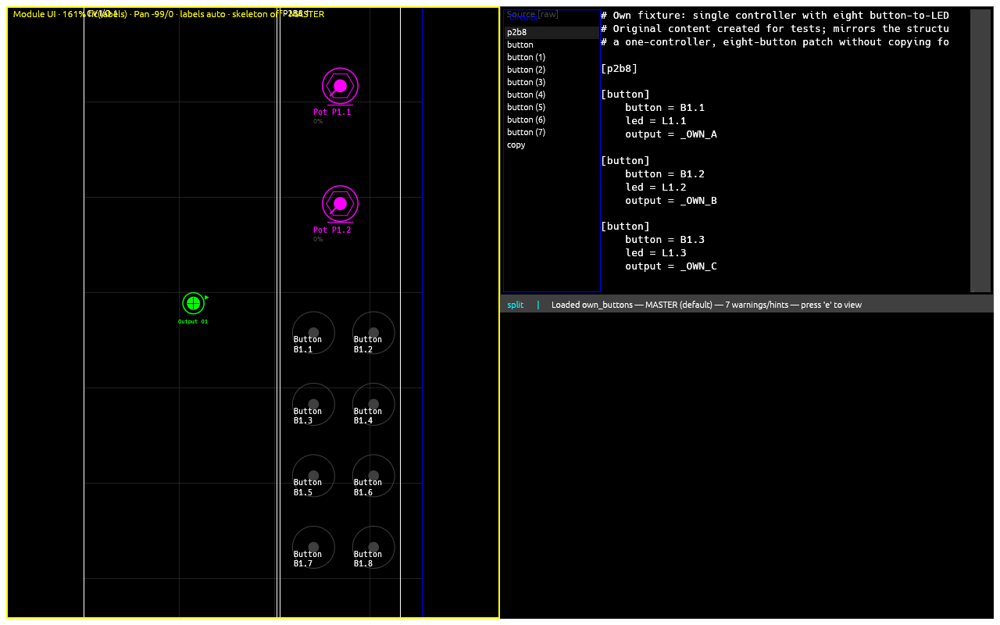
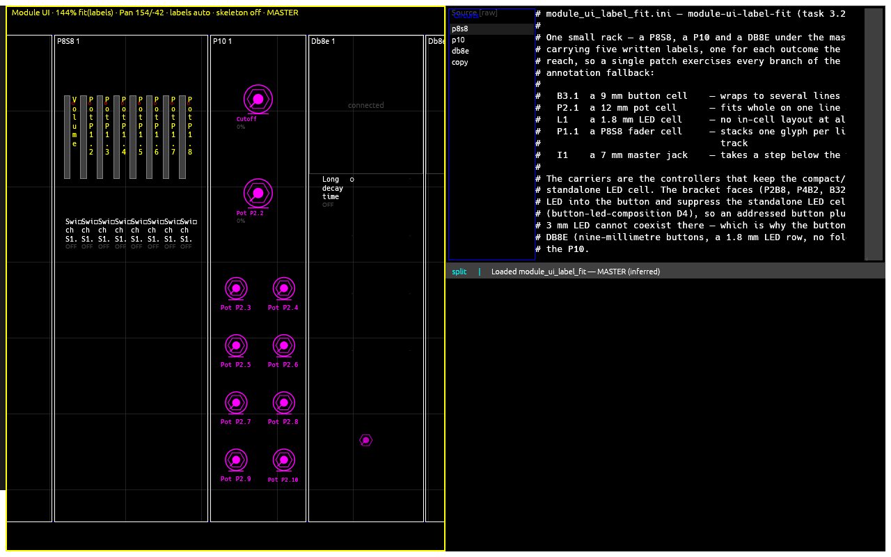
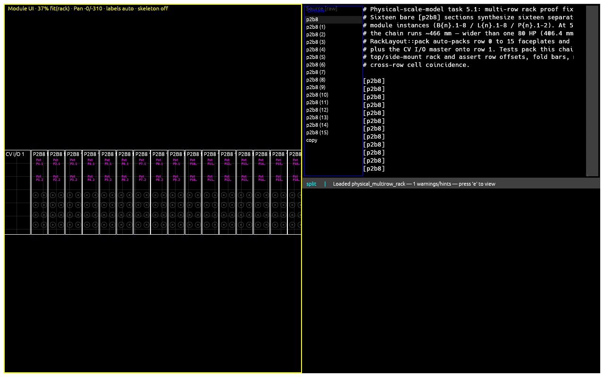
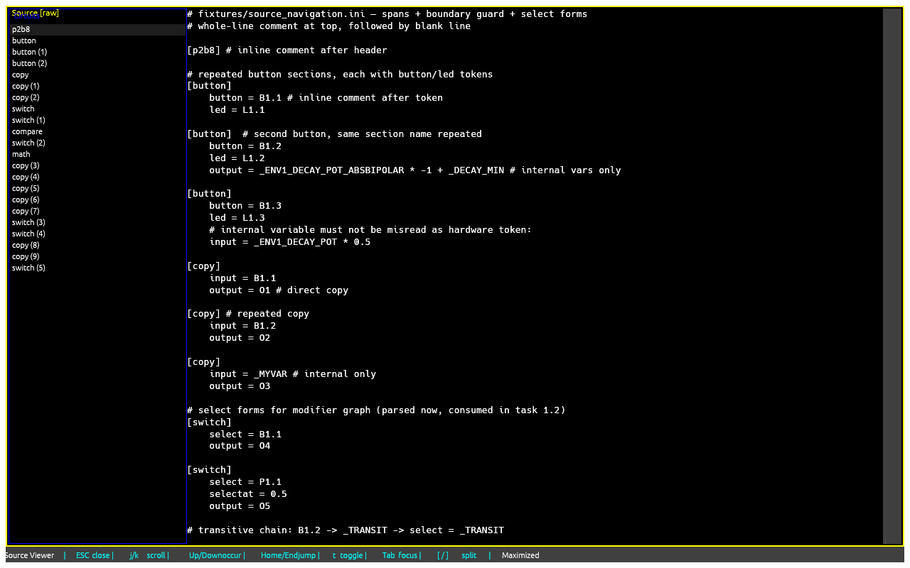
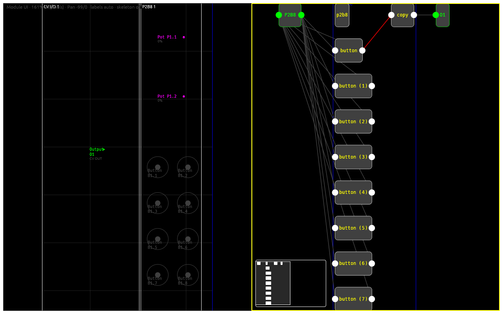
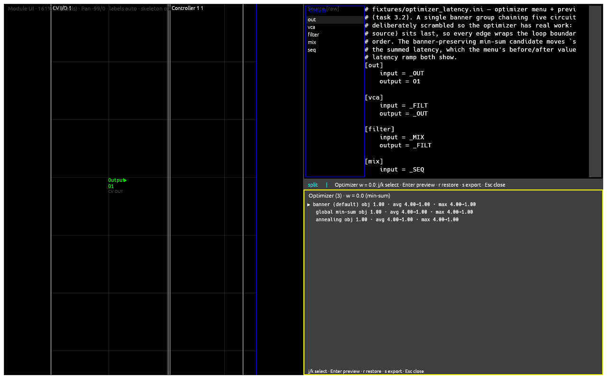

# Views

## The pane layout

The main band is a class-based layout: a full-height left **big**
pane plus a right half that is either one big pane (no small view
open) or two stacked **small** panes. Every view belongs to a class:

- Big: Module UI, signal-flow graph.
- Small: source viewer, latency optimizer.

`Tab` / `Shift+Tab` cycle focus across the open panes in tree order,
`r` rotates the focused pane through its class carousel
(big: graph → Module UI; small: source viewer → optimizer), `z`
maximizes the focused pane, `Alt+b` / `Alt+s` swap same-class panes,
`Esc` closes the focused view. `[` / `]` move the left/right split
(30–70 %), `Alt+[` / `Alt+]` move the small-pane split.

## Module UI

The physical faceplate view — the app's only hardware surface. Every
element of a declared controller renders at its faceplate position;
unused elements are drawn dimmed and unlabelled. LEDs fold into their
element and render the patch's LED color/brightness.

**Every element draws its hardware face.** A knob draws a pot face: a
washer ring 0.60 of the cell wide, a hex nut inside it whose circumradius
is 0.80 of the ring's with a flat top and bottom, a shaft at 0.38 of the
ring radius, and a slot running from 0.28 to 0.82 of that radius. The
slot carries the value on a 270° sweep — 0 at 7:30, straight up at half,
1 at 4:30 — and the face sits on a horizontal base line 0.44 of the cell
wide and 1.2 pt thick. An encoder draws the same face with no base line:
the base line is what says the control is finite and has end stops. A CV
jack draws a bezel ring around a filled socket mouth 0.40 of the cell
wide, with the cross its contacts cut into the mouth. Direction on a jack
is the `◀`/`▶` corner marker and the `CV IN`/`CV OUT` state row, never
the face colour, because the `mono` palette gives both CV tokens the same
grey.

**Detail follows the drawn face.** The symbol ladder is measured on the
ring's own diameter — not on the cell, not on the zoom — so the reduction
is right at 25 % and at 400 % alike. At 18 pt and above the face is drawn
whole. From 10 pt to 18 pt a rotary keeps the ring and the slot, and the
nut, the shaft and the base line drop; a jack keeps its ring and mouth and
loses the cross. Below 10 pt both reduce to the ring and a centre dot. A
12 mm pot (a 45 pt cell) and a 9 mm pot (34 pt) are full at 100 %; a 7 mm
encoder or master jack (26 pt) is reduced there and draws the full symbol
above about 113 %. Below 18 pt a pot and an encoder are the same drawing,
and the label and the hover reveal are what tell them apart.

**A face keeps its cell.** The symbol claims the cell's top `0.66 w` and
never shrinks or moves to make room for text: the label is fitted to the
band beneath it, `h − 0.66 w`, and the percentage row appears only when
that band still holds it after the labelled lines. The published rect,
the wheel step and the keyboard reach stay the cell's, exactly as they
were before the symbol existed.

**An unaddressed element keeps its symbol.** An unaddressed rotary is the
addressed drawing at the 0.75 alpha floor, with the washer ring dropped
at the full-detail step — the ring is what addressing adds — so the nut,
the slot and a pot's base line are what carry it; at the reduced and
centre-dot steps it keeps the addressed drawing, because a ringless slot
at that size reads as a stray stroke rather than as hardware. An
unaddressed jack keeps its whole face. Every other unaddressed kind keeps
the plain dim marker.

**The rack always starts with exactly one master faceplate**, and the
pane title names which one is drawn:

- `MASTER` — 8 HP, `I1..I8` CV inputs, `O1..O8` outputs, and the 4×4
  LED matrix beside the jacks.
- `MASTER18` — 6 HP, `O1..O8` outputs, `I1`/`I2` as gate inputs,
  `G1..G4` gate outputs, no LED matrix.

The model comes from the patch's DROID Forge declaration
(`# LABELS: master=16|18`, see [Labels](labels.md#the-master-declaration)) or,
when the patch declares none, from the one model that can host the patch;
a patch no use constrains falls back to `MASTER`. An element the drawn
master has no cell for draws no cell — the validation modal's
`master_conflict` finding names it instead.

**A configured rack inventory decides the rack.** When rows in
`config.toml` list the modules they physically hold, the view draws that
case rather than only the hardware the loaded patch happens to use. The
listed modules appear in row order and, inside a row, in list order. A
master faceplate is always present: at the position the inventory gives
it, or at the head of the rack when no row names it. Patch modules the
inventory leaves out are appended after the listed ones, in the order
the patch declares them. A listed module the patch never uses still
renders a faceplate with no components, so the hardware is visible
before anything is patched into it.

Every declared cell of an inventoried module is drawn, apart from the
folded LEDs described above. A cell a component addresses carries its
label where it has one, its state and a hit rect; every other cell is
drawn dimmed and unlabelled, has no hit rect, and stays out of keyboard
navigation, clicking, hovering, selection, the label editor and the
modifier wash. The master is no exception: an inventoried rack draws its
whole field, so a patch using two jacks still shows the other jacks, the
LED matrix and the SD button around them, dimmed.

An inventory is enough on its own. With no patch loaded the pane paints
the whole inventory rack dimmed, every cell unaddressed and no hit rect
published anywhere; the master is the default model and the pane title
names it. The fits, zoom and pan, the skeleton presentation and the label
presentations all still work, so the rack is a usable picture of the case
before a patch is chosen.

None of this changes for a user whose rack config names no modules: the
rack still follows the patch, and the master still shows only the cells
the patch uses.

**Labels are fitted per cell.** A cell's label is drawn at the largest
step of a 10, 9, 8, 7, 6 pt monospace ladder at which the whole label
fits the cell's text box, wrapping at word boundaries, breaking a word
only when a single word is too long for a line, and ellipsizing only
when even the 6 pt floor cannot hold the label. Nothing on the surface
is drawn below 6 pt. A cell that cannot fit its label at the floor — a
3 mm LED, or anything at an extreme zoom — draws no text and leaves the
label to the hover reveal and the label presentation. In-cell state text
yields to the label: when a cell cannot hold both, the label is drawn
and the state row is dropped, with the full label and the state still in
the hover reveal and the pane's status segment (fader and LED state stay
graphical either way). A tall narrow fader cell narrows its track and
stacks its label one glyph per line in the column beside it.

**The view opens at the labels fit.** Fitting happens when the view
opens, when a patch loads, when the rack changes, and when the pane is
resized — until you zoom or pan yourself, which the view then leaves
alone until you ask for a fit again. Both fits scale the rack and centre
it. `f` is the labels fit: the fitted zoom is the greater of the
whole-rack fit and the zoom every written label needs to be drawn whole,
so a dense patch opens zoomed past the pane and pans rather than
shrinking its labels away. `Shift+F` is the rack fit, the overview — the
whole rack in the pane, with labels shrinking away wherever the cells
become too small. The pane title and the status line name the fit that
ran (`fit(labels)` / `fit(rack)`), and drop the name once you zoom or
pan yourself.

**The pane draws a map of the rack.** A minimap sits inset in the pane's
bottom-right whenever the pane has a rack, including when the whole rack
already fits, so it is a persistent place-finder rather than an overflow
warning. It shows the rack case outline, one rect per module faceplate, the
focused element's module in the focus colour, and a viewport box marking the
part of the rack the pane currently shows; when everything is visible the
box is clamped inside the map and reads as the whole rack being on screen.
The panel is 160 pt wide and its height follows the rack's aspect, 56 to
120 pt, so a wide single-row case keeps the floor: the 17-faceplate multirow
rack lands on 56 pt with about 8.9 pt per module, which is why the map shows
place and extent and never module names.

**The map is a pointer surface.** A click centres the pane on the clicked
rack point at the current zoom; a drag of three points or more fits the zoom
to the dragged region; `Esc` cancels a marquee without closing the pane. The
wheel over the map does nothing — the pane keeps zooming about the pointer
everywhere else. The panel claims presses and the wheel before element
hit-testing, so a click on the map never focuses an element and a wheel over
it never adjusts a value. The map is drawn in the skeleton presentation too
and is absent in the [performance view](#performance-view), which already
shows the rack compactly.

**`c` and `Shift+C` move the camera.** `c` centres the pane on the focused
element at the current zoom, or on the rack when nothing is focused.
`Shift+C` applies the labels fit and re-arms automatic fitting: after a
manual pan or zoom, a later patch load or pane resize fits the view again.
`f` and `Shift+F` keep their own meanings, and the pair means on this pane
what it already means on the signal-flow graph.

`a` cycles the label presentation. `off` draws in-cell labels only; `on`
annotates every addressed element that carries a written label, outside
the rack with a leader line; `auto` — the default — annotates exactly the
written labels whose cell cannot draw them whole at the current zoom,
which after the labels fit is nearly always none, so `auto` stays silent
on a patch whose labels fit. Annotations add no hit rects and never move
the drawn cells.

- `j`/`k` and arrows navigate, `Enter`/`Space` toggles the hovered
  component, the mouse wheel adjusts knobs/faders.
- Click an element to **focus** it across surfaces: the cell stays
  highlighted, the source viewer jumps to its occurrence, and the
  graph highlights the element's register entity plus its influence
  subtree (centering the camera when the graph is open).
- `1`–`4` select a shift group (matching panels get bold colored
  borders, the rest dim; `Esc` clears).
- Hold or latch a modifier to wash the influenced cells: mouse-down on
  a modifier-eligible cell holds momentarily; `m` on the hovered
  component (or `Ctrl+Shift+Click`) latches until `Esc`.
- `+`/`-` cycle zoom presets (75–200 %), arrows pan when the rack
  overflows, the wheel adjusts a knob/fader and zooms about the pointer
  elsewhere, `s` toggles the skeleton reference presentation, `p` opens
  the [performance view](#performance-view), `R` resets all element
  states, `e` edits the label (or opens validation).
- `c` centres the focused element (or the rack with nothing focused),
  `Shift+C` reapplies the labels fit and re-arms automatic fitting; a
  click on the map jumps to that place and a drag frames the dragged
  region.
  
  
  

## Source viewer (`g v`)

Readonly `.ini` view in a small pane. Raw lines by default, `t`
switches to prettified circuit blocks. `j`/`k` scroll, `Up`/`Down` /
`Home`/`End` navigate the selected token's occurrences. Selection,
shift, and modifier highlights mirror the Module UI. `Esc` closes the
pane, keeping selection and scroll.

## Signal-flow graph (`g g`)

Circuits as nodes, virtual `_cable` connections as directed edges,
banner groups as cluster containers — laid out by the deterministic
column arrangement by default (titles are fixed screen-space text,
and a box without room for one draws none; `h` toggles the retained
force solver, `a` applies the active arrangement and cycles the
layout).

- Drag a node to re-settle its neighborhood; `x` toggles processing
  for the hovered circuit; `p` pins/unpins the hovered node.
- `c` centers the graph, `Shift+c` refits and centers; `+`/`-` zoom,
  arrows pan, clicking the minimap pans to the clicked point, and dragging
  a rectangle across the minimap zooms the camera to that region. The
  minimap is drawn at every zoom, so both gestures stay available.
- `f` filters to the hovered node's upstream-dependency subgraph
  (`Esc` clears the filter first); `i` toggles the influence filter.
- `g s` opens the select-state menu (assume `select` values; sections
  reclassify to Selected/NotSelected/Unknown); `g c` toggles cable
  latency coloring; `d` toggles the [diff overlay](#patch-diff-g-d-then-d).
- `Alt+[` / `Alt+]` adjust cable tension (force solver only).
- `Esc` closes the graph pane.

### Same-type grouping

Circuits of one type that stack in the drawing, or sit within two cable
hops of each other, collapse into a single labelled box — `encoder
×24` — and their cables aggregate onto it; a component with fewer than
five members stays individual. Hovering a box peeks at its contents, a
click or `Enter` expands it in place, `o` isolates the group (its
immediate neighbours dimmed), and `Shift+O` turns grouping off for the
whole graph. The `[graph]` table in `config.toml` carries
`group_enabled` and `min_group_size`.

## Latency optimizer (`g o`)

A small pane proposing section reorderings that reduce forward-loop
latency. `j`/`k` move between candidates, `[`/`]` adjust the
objective weight `w` (`0`/`1` snap it), `Enter` or a row click
previews (reorders, rebuilds, recolors latency-worse red /
latency-better blue, focuses the first affected circuit), `s` exports
to `<stem>-latopt.ini`, `r`/`Esc` restore and close.

## File picker (`l`)

Lists the current directory; `j`/`k`/arrows navigate, `Enter` selects,
typing filters (`Ctrl+f` toggles the filter, `Backspace` edits,
`q` ends it), `f`/`F` toggles a favourite, `0`–`9` fast-select a
favourite slot, `Esc` closes.

## Validation modal (`e`)

Lists schema and lint findings sorted by source position with severity
badges (E/W/H). `j`/`k` navigate, `Enter` jumps the source viewer to
the issue's `line:col`, `Esc`/`e` closes. Any `Error`-severity finding
gates the load (the patch is rejected); warnings and hints load with
a `press 'e' to view` status hint.

Two findings report the master fit:

- `master_conflict` (W) — the resolved master cannot host a jack or
  circuit the patch uses (a `MASTER18` patch reading `I3`, a `MASTER`
  patch with a `[vcotuner]` section). The finding names the use and
  the model that would host it, and the patch still loads.
- `no_master_fits` (E) — no master model can host the patch, so the
  load is refused.

## Patch diff (`g d`, then `d`)

`g d` opens the picker to choose the second (B) patch; the diff
computes once. `d` toggles the overlay, `Esc` clears the diff scope.
The graph colors added/removed/changed cables and nodes; the status
bar shows `Diff scope: <token> (N cables)`.

## Performance view

`p` on the Module UI pane opens an exploded-label presentation:
a compact centered rack with big side-bound callouts and leader
lines. Activating an element updates its callout live, `R` resets all
element states, `Esc` leaves the view.

## Select-state menu (`g s`)

Lists the patch's discovered Register/Cable select signals with
inferred candidate values. `j`/`k` move, `[`/`]`/`Enter` cycle the
value (rebuilding the graph each step), `Esc` clears and restores the
default graph. The status reports
`Select state: N selected / M unselected / K unknown`.
